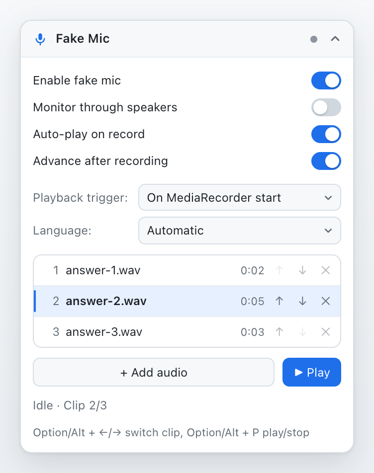
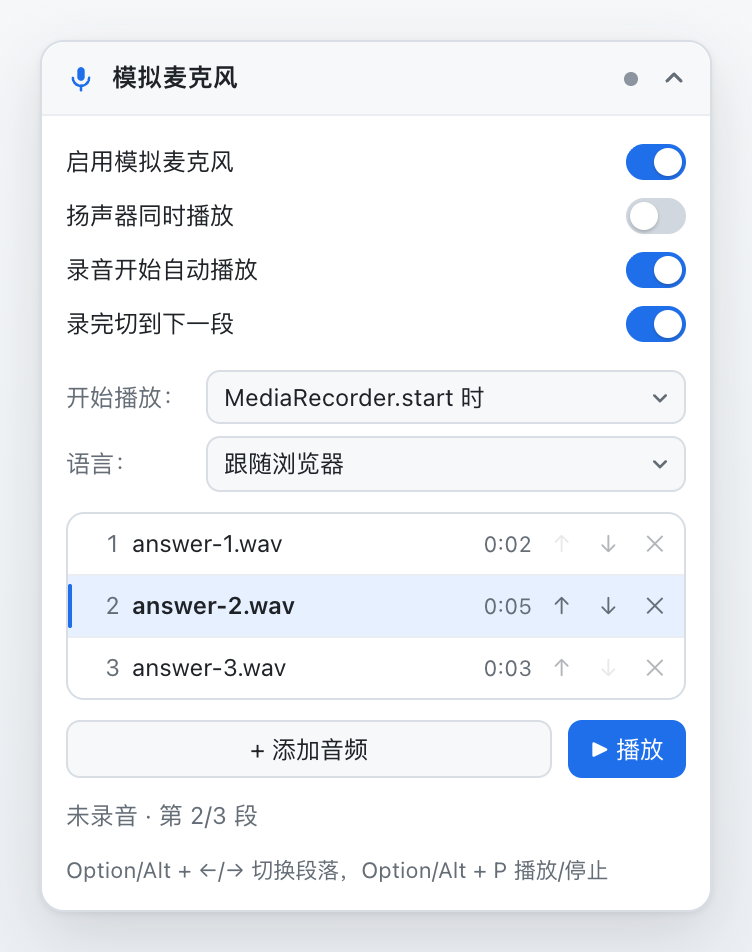
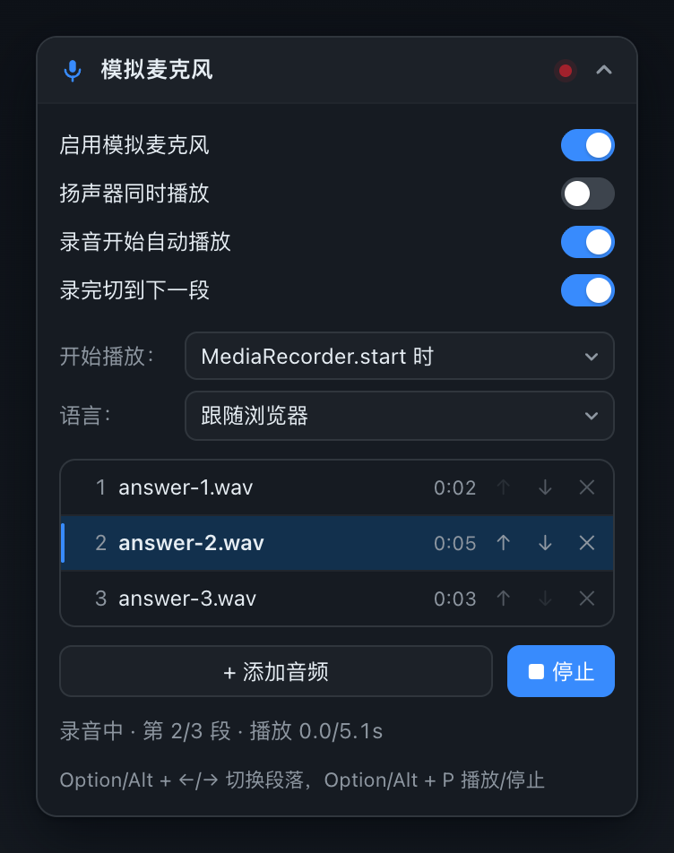
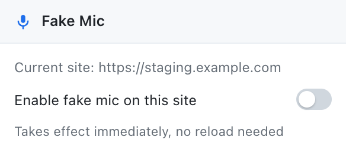

# Fake Mic — Feed a microphone from audio files (Chrome extension)

[中文说明](README.zh-CN.md)

<p align="center">
  
</p>

<p align="center">
  <a href="https://github.com/9heart1111/fake-mic-extension/actions/workflows/test.yml"></a>
  <a href="manifest.json"></a>
  <a href="LICENSE"></a>
  
</p>

Testing a recording feature shouldn't require talking into a microphone over and over. This extension replaces the audio returned by `navigator.mediaDevices.getUserMedia` with an audio file you upload — so multi-round recording tests can play a different clip each round, hands-free.

- **No virtual audio device needed** — no BlackHole, no Soundflower, and no changes to the app under test.
- **The page still gets a real `MediaStream`** — `MediaRecorder`, Web Audio, `MediaStreamTrack`, and anything else that consumes microphone input works as usual.
- **Clips end in silence, not in a stopped track** — when a clip finishes, the track keeps outputting silence instead of ending. To the page this looks like a person pausing after speaking, not like the microphone was unplugged.
- **Works on any site you opt in to** — `localhost` and `127.0.0.1` are always on; staging domains, tunnels and LAN addresses can be enabled from the toolbar popup, with no reload.
- **English and Chinese UI, light and dark** — the panel follows your browser language and colour scheme, and both can be switched at any time.

## Install

Clone the repository (or download the ZIP from GitHub):

```bash
git clone https://github.com/9heart1111/fake-mic-extension.git
```

1. Open `chrome://extensions` and turn on **Developer mode** (top right).
2. Click **Load unpacked** and select this project's root directory (the one containing `manifest.json`).
3. After editing the extension, hit the reload button on the extensions page, then refresh the page under test.

The extension is available on every `http`/`https` page, but it only takes over the microphone where you enable it: `localhost` and `127.0.0.1` are always on, and any other site needs one click in the toolbar popup — click the Fake Mic icon (pin it from the puzzle-piece menu if you don't see it), then tick **Enable fake mic on this site**. The change applies to open tabs immediately.

Because `getUserMedia` only exists in a secure context, a plain-`http` page served from a LAN IP (e.g. `http://192.168.1.10:3000`) cannot record at all, with or without this extension. Either serve the page over HTTPS (an `ssh -L 3000:localhost:3000` tunnel to `localhost` also works), or start Chrome with `--unsafely-treat-insecure-origin-as-secure=http://192.168.1.10:3000` (the same origin can be set in `chrome://flags/#unsafely-treat-insecure-origin-as-secure`).

The install prompt asks for permission to read and change data on all sites — that is what lets the extension follow you to any test environment. On sites you haven't enabled it does nothing: no panel is injected, `getUserMedia` is passed straight through to the real microphone, and your clips are never sent to the page.

## Usage

A **Fake Mic** panel appears in the bottom-right corner of the page, in English or Chinese depending on your browser language. It can be dragged anywhere and collapsed into a small pill.

1. Click **+ Add audio** or drag audio files straight onto the panel. Supported: mp3, wav, m4a, ogg, webm — you can select several at once. Clips are stored inside the extension, shared across all enabled pages, and survive page reloads.
2. Click a row to make it the **current clip**; use ↑ ↓ to reorder and ✕ to delete.
3. Start recording in the page. The extension plays the current clip automatically and advances to the next one when the recording ends — line up your clips and each round answers with the next one.

| Option | Effect |
| --- | --- |
| Enable fake mic | When off, the page uses the real microphone |
| Auto-play on record | When off, start playback manually with **▶ Play** or the shortcut — useful for simulating a pause before speaking |
| Advance after recording | Select the next clip after each recording ends |
| Monitor through speakers | Play the clip through your speakers as well |
| Playback trigger | `On MediaRecorder start` (default): play when the page starts recording. `On getUserMedia`: play as soon as the page obtains the microphone — for pages that don't use `MediaRecorder` (e.g. streaming recognition via AudioWorklet). In this mode, the page stopping the track counts as the recording ending |
| Language | `Automatic` (default) follows your browser language; `中文` and `English` pin the panel to that language |

The toolbar popup enables or disables the extension per site; `localhost` and `127.0.0.1` are always enabled and can't be switched off there.

Shortcuts (active on the page under test):

- `Option/Alt + →` / `Option/Alt + ←` — next / previous clip
- `Option/Alt + P` — play / stop. Pressing it mid-recording restarts the current clip

If the status line reads **"Audio inactive — click the panel"**, the browser's autoplay policy is blocking audio — click the panel once to resume.

## Screenshots

| Panel — English | Panel — 中文 |
| --- | --- |
|  |  |

| Recording, dark theme | Toolbar popup |
| --- | --- |
|  |  |

## How it works

1. [`src/main-world.js`](src/main-world.js) runs in the page's main world and wraps `navigator.mediaDevices.getUserMedia`. For audio requests it returns a track from a `MediaStreamAudioDestinationNode`, fed by a Web Audio graph playing your clip.
2. [`src/panel.js`](src/panel.js) runs in the isolated world, owns the clip library in `chrome.storage.local`, and messages the main world over `window.postMessage`.
3. The main world watches `MediaRecorder.prototype.start` (or the `getUserMedia` return, depending on the trigger) to start playback, and advances to the next clip when the recording ends.
4. Nothing is patched until the panel confirms the current site is enabled for this tab, so the extension stays invisible everywhere else.

## Translations

The panel and popup are available in both English and Chinese. Strings live in two places:

- [`src/i18n.js`](src/i18n.js) — every label inside the floating panel and the toolbar popup. The default `Automatic` setting uses Chinese when the browser UI language starts with `zh`, and English otherwise.
- `_locales/<locale>/messages.json` — the extension name and description Chrome displays, using Chrome's own i18n format. Currently `en` (the default locale) and `zh_CN`.

To add a language, copy the `en` table in `src/i18n.js` plus `_locales/en/messages.json` into a new entry, and open a pull request.

## Known limitations

- **No `webkitSpeechRecognition` / `SpeechRecognition` support.** Those APIs read the system microphone directly and never go through `getUserMedia`.
- **Needs a secure context** — HTTPS, `localhost`, or another loopback address such as `127.0.0.2`. Plain-HTTP LAN addresses have no `navigator.mediaDevices` at all; see [Install](#install) for the workaround.
- `enumerateDevices` and `navigator.permissions.query` are **not** patched — pages that inspect the device list or microphone permission state see the real thing.
- If a page hands the microphone stream to its own `AudioContext` and records the *processed* stream, the `On MediaRecorder start` trigger can't recognise the fake track. Use the `On getUserMedia` trigger instead.
- The status line only reflects recordings in the top-level page. When recording happens inside an iframe the audio is still replaced and clips still advance, but the status line won't show "recording".
- Clips are stored as base64 in extension storage — keep individual files to tens of MB at most.

## Development & tests

```bash
npm install
npx playwright install chromium   # first run only
npm test
```

The test run boots a Chromium with the extension loaded, records on a test page served from `127.0.0.1:4321`, and analyses the frequency of the captured audio to verify:

- the recording contains the currently selected clip, and the track stays live after the clip finishes;
- recording completion advances to the next clip, so the following round captures the new one;
- sites that aren't enabled keep the real microphone and never see the panel, and enabling one in the popup takes effect on an already-open tab;
- the panel follows the browser language, can be switched in the panel, and remembers the choice across reloads;
- with the extension disabled, the page gets the real microphone (Chrome's fake device, fed a fixed tone by the test).

Two helper scripts keep the repository assets in sync:

```bash
npm run screenshots   # regenerate docs/screenshots from the real UI
npm run icons         # regenerate icons/ from the SVG source in scripts/icons.mjs
```

## Files

- [`manifest.json`](manifest.json) — extension manifest (Manifest V3).
- [`src/main-world.js`](src/main-world.js) — page main world: patches `getUserMedia`, watches `MediaRecorder` start/stop, plays clips through Web Audio. Stays inert until the panel confirms the site is enabled.
- [`src/panel.js`](src/panel.js) — isolated world: site gating, the floating panel, the clip library and shortcuts.
- [`src/popup.html`](src/popup.html) / [`src/popup.js`](src/popup.js) — toolbar popup: shows the current site and toggles the per-site allowlist.
- [`src/i18n.js`](src/i18n.js) — panel and popup strings for English and Chinese, plus language resolution.
- `_locales/` — extension name and description per browser language (`en`, `zh_CN`).
- `icons/` — toolbar and extensions-page icons.
- `.github/` — the CI workflow that runs the test suite, plus the bug report template.
- `tests/` — Playwright end-to-end tests, the test page and a static server.
- `scripts/` — asset generators for the screenshots and icons.
- `docs/screenshots/` — the images used in this README.

## Contributing

Issues and pull requests are welcome. [CONTRIBUTING.md](CONTRIBUTING.md) covers the local setup, the few conventions this project follows (no build step, strings in both languages, generated screenshots) and some ideas that would be nice to have.

## License

[MIT](LICENSE)
