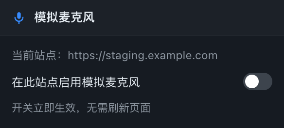

# Fake Mic：用音频文件模拟麦克风的 Chrome 插件

[English](README.md)

<p align="center">
  
</p>

<p align="center">
  <a href="https://github.com/9heart1111/fake-mic-extension/actions/workflows/test.yml"></a>
  <a href="manifest.json"></a>
  <a href="LICENSE"></a>
  
</p>

测试录音功能时不用对着麦克风说话：插件替换页面里 `navigator.mediaDevices.getUserMedia` 返回的音频，改成你上传的音频文件。适合多轮录音测试，每一轮可以用不同的音频段。

- 不需要 BlackHole 等虚拟声卡，也不用改被测项目的代码。
- 页面拿到的是真正的 `MediaStream`，`MediaRecorder`、Web Audio 都能照常处理。
- 音频段播完后音轨不会结束，而是继续输出静音，相当于真人说完话停下来，不会被页面当成“麦克风断开”。
- 任何站点都能用，按站点开启：`localhost` 和 `127.0.0.1` 默认始终生效，staging 域名、内网穿透地址、局域网 IP 在工具栏弹窗里点一下即可，不用刷新页面。
- 界面支持中文和英文、浅色和深色：默认跟随浏览器语言和系统配色，也都可以随时切换。

## 安装

先把仓库克隆下来（也可以在 GitHub 页面下载 ZIP）：

```bash
git clone https://github.com/9heart1111/fake-mic-extension.git
```

1. 打开 `chrome://extensions`，打开右上角的“开发者模式”。
2. 点“加载已解压的扩展程序”，选择本项目根目录（`manifest.json` 所在的目录）。
3. 改了插件代码后，在扩展页点刷新按钮，再刷新被测页面。

插件在所有 `http` / `https` 页面上都会注入，但只在你允许的站点上接管麦克风：`localhost` 和 `127.0.0.1` 始终生效，其它站点需要点一下工具栏上的 Fake Mic 图标（没显示的话先从拼图菜单里固定出来），勾上“在此站点启用模拟麦克风”。已打开的标签页会立即生效，不用刷新。

`getUserMedia` 只在安全上下文里存在，所以用局域网 IP 通过纯 HTTP 打开的页面（例如 `http://192.168.1.10:3000`）本来就无法录音，装不装本插件都一样。三种解决办法：给页面套 HTTPS；或者用 `ssh -L 3000:localhost:3000` 转发出来当 `localhost` 访问；或者在启动 Chrome 时加 `--unsafely-treat-insecure-origin-as-secure=http://192.168.1.10:3000`（也可以改 `chrome://flags/#unsafely-treat-insecure-origin-as-secure`）。

安装时会提示“读取和更改你在所有网站上的数据”，这是“任何站点都能按需启用”的代价。在你没启用的站点上插件什么都不做：面板不会注入，`getUserMedia` 原样走真实麦克风，你的音频段也不会被发送到页面里。

## 使用

打开被测页面后，右下角会出现“模拟麦克风”面板，界面语言跟随浏览器（也可以在面板里切换）。面板可以拖到任意位置，也能折叠成一个小胶囊。

1. 点“+ 添加音频”，或者直接把音频文件拖到面板上，支持 mp3、wav、m4a、ogg、webm，可以一次选多个。音频保存在插件里，所有已启用的页面共用，刷新页面后不会丢。
2. 点列表里的某一行，把它设为当前段；用 ↑ ↓ 调整顺序，✕ 删除。
3. 在页面上点开始录音，插件会自动播放当前段，录完后自动切到下一段。多轮测试时，按顺序排好音频，依次答题就行。

| 选项 | 作用 |
| --- | --- |
| 启用模拟麦克风 | 关闭后页面使用真实麦克风 |
| 录音开始自动播放 | 关闭后需要手动点“▶ 播放”或按快捷键，可以模拟停顿一会儿再说话 |
| 录完切到下一段 | 每次录音结束后选中下一段 |
| 扬声器同时播放 | 播放时你也能听到声音 |
| 开始播放 | `MediaRecorder.start 时`：默认值，页面开始录音时播放。`getUserMedia 返回时`：页面拿到麦克风时就播放，用于不用 MediaRecorder 的页面（例如用 AudioWorklet 做流式识别），这种模式下页面停止音轨时视为录音结束 |
| 语言 | `跟随浏览器`（默认）：界面语言跟随浏览器。选 `中文` 或 `English` 可以固定面板语言 |

工具栏弹窗负责按站点开关插件；`localhost` 和 `127.0.0.1` 始终启用，在弹窗里关不掉。

快捷键（在被测页面上使用）：

- `Option/Alt + →` / `Option/Alt + ←`：切到下一段 / 上一段
- `Option/Alt + P`：播放 / 停止。录音中途按下可以重新开始播放当前段

状态行如果显示“音频未激活，点一下面板”，说明浏览器的自动播放策略挡住了声音，点一下面板就能恢复。

## 界面截图

| 面板 · 中文 | 面板 · English |
| --- | --- |
|  |  |

| 录音中（深色） | 工具栏弹窗 |
| --- | --- |
|  |  |

## 工作原理

1. [`src/main-world.js`](src/main-world.js) 运行在页面主世界，包住 `navigator.mediaDevices.getUserMedia`：音频请求会返回一条由 `MediaStreamAudioDestinationNode` 产生的音轨，背后是 Web Audio 在播放你的音频段。
2. [`src/panel.js`](src/panel.js) 运行在隔离世界，负责音频库（`chrome.storage.local`），通过 `window.postMessage` 告诉主世界播哪一段、什么时候播。
3. 主世界监听 `MediaRecorder.prototype.start`（或按“开始播放”选项监听 `getUserMedia` 返回）来开始播放，录音结束时自动切下一段。
4. 在面板确认当前站点已启用之前，主世界不会改写任何东西，所以其它站点上插件完全不可见。

## 多语言

面板和弹窗内置中文和英文，文案分两处存放：

- [`src/i18n.js`](src/i18n.js)：面板和工具栏弹窗里的所有文字。默认的“跟随浏览器”在浏览器界面语言以 `zh` 开头时用中文，其余用英文。
- `_locales/<locale>/messages.json`：Chrome 扩展页显示的名称和简介，用的是 Chrome 自带的 i18n 格式。目前有 `en`（默认语言）和 `zh_CN`。

要新增一种语言，把 `src/i18n.js` 里的 `en` 文案表和 `_locales/en/messages.json` 复制一份改成新语言，然后提 PR 即可。

## 已知限制

- 不支持 `webkitSpeechRecognition` / `SpeechRecognition`：这类接口由浏览器直接读取系统麦克风，不经过 `getUserMedia`。
- 需要安全上下文（HTTPS、`localhost`，或 `127.0.0.2` 这类 loopback 地址）。纯 HTTP 的局域网 IP 页面连 `navigator.mediaDevices` 都没有，解决办法见[安装](#安装)。
- 没有改写 `enumerateDevices` 和 `navigator.permissions.query`，依赖设备列表或麦克风权限状态的页面看到的是真实情况。
- 页面如果先把麦克风的流交给自己的 AudioContext 处理，再录制处理后的流，`MediaRecorder.start 时` 识别不出这是模拟音轨，请改用 `getUserMedia 返回时`。
- 状态行只反映顶层页面里的录音；录音发生在 iframe 内时，音频照常替换、自动切段也正常，但状态行不会显示“录音中”。
- 音频以 base64 存在插件本地存储里，单个文件建议不超过几十 MB。

## 开发与测试

```bash
npm install
npx playwright install chromium   # 首次运行
npm test
```

测试会启动一个加载了本插件的 Chromium，在 `127.0.0.1:4321` 的测试页上录音，再分析录到声音的频率，检查：

- 录到的是当前选中的段落，段落播完后音轨仍然在线；
- 录完会自动切到下一段，下一轮录到的是新段落；
- 没启用的站点拿到的是真实麦克风、也不会出现面板；在弹窗里启用后，已打开的页面立即生效；
- 面板语言跟随浏览器设置，可以在面板里切换，刷新后仍然保持；
- 关闭插件后，页面拿到的是真实麦克风（测试给 Chrome 的模拟设备喂了固定音调）。

仓库里的截图和图标也是脚本生成的：

```bash
npm run screenshots   # 用真实界面重新生成 docs/screenshots
npm run icons         # 用 scripts/icons.mjs 里的 SVG 重新生成 icons/
```

## 文件

- [`manifest.json`](manifest.json)：插件清单（Manifest V3）。
- [`src/main-world.js`](src/main-world.js)：运行在页面主世界，替换 `getUserMedia`，监听 `MediaRecorder` 的开始和停止，用 Web Audio 播放音频段；在面板确认站点被允许之前保持静默。
- [`src/panel.js`](src/panel.js)：运行在隔离世界，判断当前站点是否可用，负责悬浮面板、音频库和快捷键。
- [`src/popup.html`](src/popup.html) / [`src/popup.js`](src/popup.js)：工具栏弹窗，显示当前站点并开关本站白名单。
- [`src/i18n.js`](src/i18n.js)：面板和弹窗的中英文文案，以及语言解析逻辑。
- `_locales/`：按浏览器语言显示的插件名称和简介（`en`、`zh_CN`）。
- `icons/`：工具栏和扩展页使用的图标。
- `.github/`：跑测试的 CI 工作流，以及 issue 模板。
- `tests/`：Playwright 端到端测试、测试页和静态服务器。
- `scripts/`：截图和图标的生成脚本。
- `docs/screenshots/`：本 README 里用到的图片。

## 参与贡献

欢迎提 issue 和 PR。本地怎么跑、项目的一些约定（没有构建步骤、文案中英文都要补、截图由脚本生成），以及一些可以做的方向，都写在 [CONTRIBUTING.md](CONTRIBUTING.md) 里。

## 开源协议

[MIT](LICENSE)
